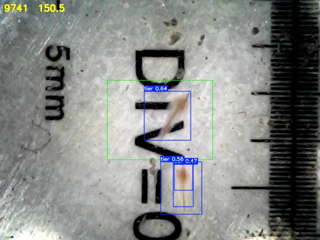
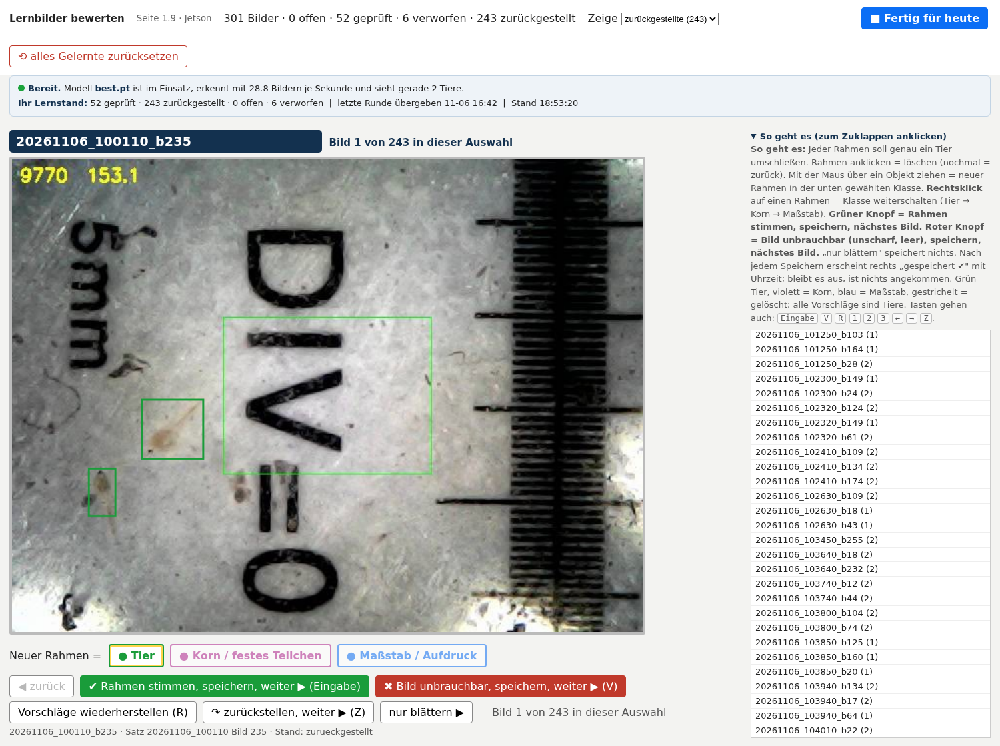

# Salzkrebszucht überwachen: Mikroskopkamera mit motorischem Autofokus am Raspberry Pi 5, Jetson Orin Nano erkennt und zählt mit YOLO

**Autoren:** Prof. Dr.-Ing. Ralph Wystup M.Sc. und Claude (Anthropic, Claude Code) — gemeinsam erstellt · Fassung 1.1 vom 07.11.2026

**Seite:** https://ralphwystup.github.io/Salzkrebszucht-ueberwachen-Mikroskopkamera-mit-motorischem-Autofokus-Raspberry-Pi-5-und-Jetson-YOLO/ —
Bedienen, Statistik, Lernen, Hardware, Beschreibung, Manuskript (Teil A Autofokus, Teil B Beobachtung und YOLO), Messungen,
Zusammenarbeit mit der KI. Dieselbe Seite läuft live auf dem Pi mit Bild, Kurve, Punkten und den Zahlen des Jetson.

**Kurzbeschreibung.** Eine Salzkrebszucht (*Artemia*, Lebendfutter der Aquakultur) wird unter einem einfachen USB-Mikroskop
überwacht. Der motorische Autofokus (Servo am Rändelrad, Teil A) hält das Bild scharf. Ein **Raspberry Pi 5** liefert Bild,
Schärfe, Anzeige und eine regelbasierte Verfolgung der Tiere — und läuft allein, wenn alles andere ausfällt. Ein **Jetson Orin Nano**
liest den Livestrom mit, sammelt die Aufnahmen, lässt sich Lernbilder vom Menschen bewerten (Lernseite mit der Maus), lernt daraus auf
dem Gerät ein **YOLOv8**-Modell und liefert die Statistik zurück auf die Seite des Pi: Tiere je Bild, bewegt oder ruhend, Körpergröße,
Tempo, Stundenzähler — mit einem Livebild, in dem jeder erkannte Rahmen in Echtzeit eingezeichnet ist.

**Anwendungsfall:** Überwachung der Salzkrebszucht — wie viele Tiere, ob sie leben und sich bewegen, wie groß sie werden. Die nächste
Runde Lernbilder startet das Nachtraining mit einem Knopf; das Modell wird im Lauf nachgeladen.

## Was gemessen wurde (06.11.2026)

| Größe | Wert |
|:--|--:|
| YOLOv8n auf dem Jetson, PyTorch FP16 | 49,8 Bilder/s |
| YOLO-Livedienst am Strom des Pi, mit Verfolgung (ByteTrack) | 28,8 von 28,8 Bildern/s |
| Livestrom Pi → Jetson | 30 Bilder/s, 11 Mbit/s |
| Training mit 52 bewerteten Bildern (43/9), YOLOv8n, 40 Epochen | 215 s, mAP@0,5 = 0,53 |
| Erstes Modell aus 301 Bildern mit Vorschlagsrahmen | 12 min, mAP@0,5 = 0,65 |
| Problem „Pi verpasst Tiere": Anteil, der schon am Bewegungsmodell scheitert | 75 % |
| Zusammenspiel Pi · Jetson · Brücke · Browser, Prüfer mit 17 Schritten | 17 von 17 belegt |

## Was am 07.11.2026 dazukam

| Größe | Wert |
|:--|--:|
| YOLO gegen die Rahmen von Hand, Schwelle 0,40 (wie im Livedienst) | 10 % Trefferquote |
| dieselbe Messung bei Schwelle 0,25 | 32 bis 38 % |
| dieselbe Messung bei Schwelle 0,10 | 62 bis 78 % |
| Tiere, die der Mensch nachtragen musste (keine Maschine fand sie) | 43 von 209 |
| Farbregel: Verlust an der Ortsfest-Maske über dem Aufdruck | 8,6 %, daneben 0 % |
| Farbregel: Verlust am Flächenfenster | 8,1 % |
| zwei getrennt verfolgte Tiere näher als 50 px | 12 von 191 214 Bildern |
| Lichtfarbe über 25 Stunden, Blau zu Rot | 1,6 % Schwankung |
| Schwelle S > 40 als beste Schwelle, über 160 Sätze | in 0 von 160 |
| Rechenlast des Pi | 2,12 von 4 Kernen; die Last trägt die Speicherkarte |
| Browserproben der Lernseite und der Seite | 87 Prüfpunkte, alle bestanden |

Jede dieser Proben fällt an der jeweiligen Vorgängerfassung durch — eine Probe, die nie rot wird, beweist nichts.
Einzelheiten in `protokolle/PROTOKOLL_2026-11-07.md`.

Ein Filmausschnitt (5,9 s, der tierreichste Satz mit Video nach YOLO-Zählung, 06.11.2026 17:33 Uhr) liegt in `video/`: [roh](video/clip_roh_2026-11-06.mp4) und [mit den Rahmen des Modells](video/clip_yolo_2026-11-06.mp4); auf der Seite läuft er im Manuskript, Kapitel 13.

## Aufbau

* **Pi:** `pi/autofokus4.py` (Fokusdienst mit Seite, Teil A), `pi/auswertung_1.4.py` (Bildwächter: MOG2, Form und Farbe,
  Verfolgung, Aufzeichnung), systemd-Einheiten, `pi/EINRICHTEN.md`.
* **Jetson:** `jetson/jetson_dienst_1.12.py` (Sätze holen, Farbwahrheit, Statistik, Aufräumen, Livestrom, Aufträge, Dateien,
  Lernseite, Fertig → Training), `jetson_yolo_live_1.3.py` (Livedienst mit `/stand` und `/strom`), `jetson_yolo_training_1.4.py`,
  `jetson_yolo_datensatz_1.1.py`, `jetson_lernbilder_1.0.py`, `jetson_lernbilder_auswahl_1.0.py`, `tiere_nach_farbe_1_6.py`,
  `jetson_yolo_einrichten_1.3.py` (Einheiten mikroskop-training und mikroskop-yolo, sudoers), Starter mit Fassungsdatei.
* **Lernseite:** `lernseite/lernen_1.9.html` — Rahmen bewerten mit der Maus, Klassen Tier/Korn/Maßstab, Fertig-Knopf.
* **Prüfung:** `pruefung/zusammenspiel_pruefen_1.5.py` (P1–P17), Browserproben mit Playwright, Stellvertreter des Fokusdienstes.
* **Messprogramme (07.11.2026):** `jetson/jetson_nummernwechsel_1.1.py` (dichte Tiere), `jetson_lichtfarbe_1.1.py` (Lichtfarbe über
  die Zeit), `jetson_zaehlgenauigkeit_1.1.py` (YOLO und Farbregel gegen die Rahmen von Hand), `jetson_farbschwelle_1.0.py`,
  `jetson_farbfilter_1.0.py` (an welcher Stufe die Farbregel verliert), `pi/pi_last_messen_1.0.py`, `pi_warten_messen_1.0.py`,
  `pi_schreiber_messen_1.0.py` (Rechenlast, Wartezeit, Schreiblast des Pi).
* **Protokolle und Befunde:** `protokolle/` — das Prüfprotokoll vom 07.11.2026 mit 87 Prüfpunkten, die Befunde zu den
  Problemen 1, 6, 7 und 9, der Befund zur Lernseite, dazu Lagebericht und Befund zu Problem 4 vom 06.11.;
  `literatur/` (Auswertung mit der Kurzfassung von Wang und De Baets, Gent 2019, CC BY 4.0).
* **Manuskript:** `manuskript/Manuskript_Salzkrebszucht_1.1.pdf` (Teil A und B) und als Reiter in der Seite.
* **Brücke:** `bruecke/` — die Werkzeuge, mit denen die KI über den PC des Verfassers Pi und Jetson erreicht (Aufträge, Dateien,
  Zugang ohne Kennwort in Befehlen). Adressen und Pfade sind durch Platzhalter ersetzt.

## Grundsätze, die hier gelten

* Der Pi wartet nie auf den Jetson; fällt der Jetson aus, fehlt nur die Statistik (Browserprobe P8).
* Jede Fassung daneben, Rückfall benannt; geprüfte Fassungen bleiben unverändert.
* Jede Seite wird im echten Browser durchgespielt, bevor sie auf das Gerät geht.
* Kennwörter nie in Befehlen; Aufträge und Dateien laufen über den Pi, nicht über Zugangsdaten.

## Stichworte

Artemia, Salzkrebse, brine shrimp, Lebendfutter, Aquakultur, Zuchtüberwachung, USB-Mikroskop, motorischer Autofokus, Raspberry Pi 5,
Jetson Orin Nano, YOLOv8, Objekterkennung, Edge-KI, Training auf dem Gerät, Lernbilder, Bildauswertung, Bewegungserkennung (MOG2),
Tierverfolgung, ByteTrack, OpenCV, Planktonkamera, Mikroskopie.

## Lizenz

MIT (siehe `LICENSE`). Die Kurzfassung in `literatur/` steht unter CC BY 4.0 bei ihren Verfassern.
